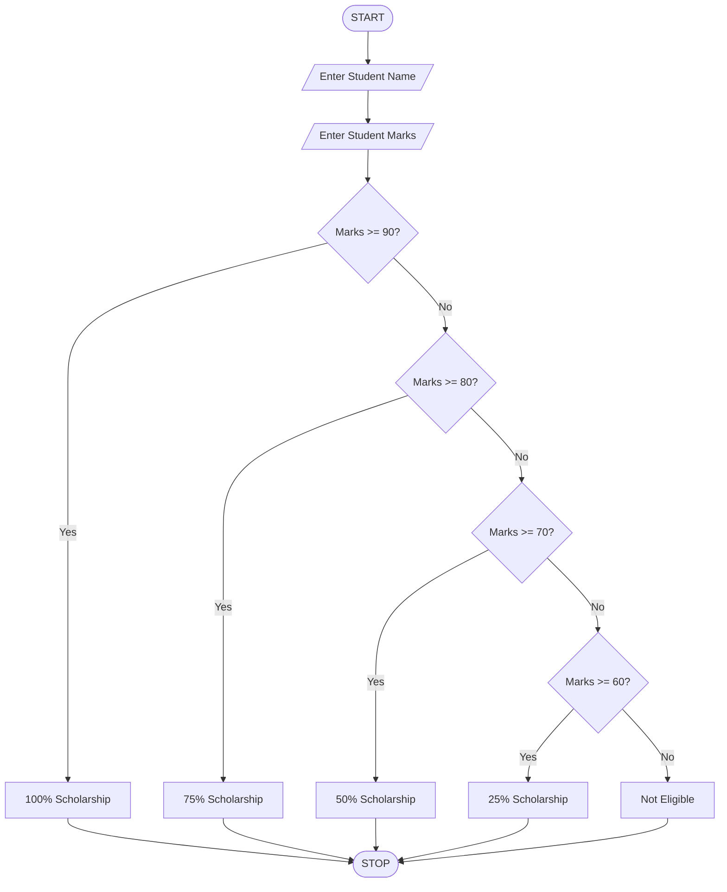

## Problem Statement
The Student Scholarship Allocation System is designed to calculate the scholarship percentage for students based on their academic marks.
The system accepts the student's name and marks as input. Based on the marks obtained, it allocates a scholarship percentage according to the following conditions:
- Marks 90 and above: 100% Scholarship.
- Marks 80 to 89: 75% Scholarship.
- Marks 70 to 79: 50% Scholarship.
- Marks 60 to 69: 25% Scholarship.
- Marks below 60: Not Eligible for Scholarship.
The main purpose of this system is to make scholarship allocation simple, fast, and accurate.

## Objectives
1. To accept the student's name and marks.
2. To check the student's marks.
3. To allocate scholarships based on marks.
4. To identify eligible and non-eligible students.
5. To reduce manual calculation.
6. To provide accurate results.

##  Assumptions
1. The student's name must be entered.
2. Marks should be entered as an integer.
3. Marks are between 0 and 100.
4. Scholarship eligibility depends only on marks.
5. Students scoring below 60 are not eligible.
6. Each student receives only one scholarship percentage.

## Algorithm
Step 1: Start the program.

Step 2: Enter the student's name.

Step 3: Enter the student's marks.

Step 4: Check whether marks are greater than or equal to 90.

- If yes, display 100% scholarship.

Step 5: Otherwise, check whether marks are greater than or equal to 80.

- If yes, display 75% scholarship.

Step 6: Otherwise, check whether marks are greater than or equal to 70.

- If yes, display 50% scholarship.

- Step 7: Otherwise, check whether marks are greater than or equal to 60.

- If yes, display 25% scholarship.

Step 8: Otherwise, display Not Eligible for Scholarship.

Step 9: Stop the program.

## Flowchart

## pseudocode

START

INPUT student name
INPUT student marks

IF marks >= 90 THEN
    PRINT student name
    PRINT "Scholarship: 100%"

ELSE IF marks >= 80 THEN
    PRINT student name
    PRINT "Scholarship: 75%"

ELSE IF marks >= 70 THEN
    PRINT student name
    PRINT "Scholarship: 50%"

ELSE IF marks >= 60 THEN
    PRINT student name
    PRINT "Scholarship: 25%"

ELSE
    PRINT "Not Eligible for Scholarship"

END IF

STOP

## Sample testcases

Case1:&nbsp;

Enter student name: Ravi&nbsp;

Enter student marks: 95&nbsp;

Student Name: Ravi&nbsp;

Scholarship: 100%&nbsp;

case2:&nbsp;

Enter student name: Priya&nbsp;

Enter student marks: 85&nbsp;

Student Name: Priya&nbsp;

Scholarship: 75%&nbsp;

case3:&nbsp;

Enter student name: Rahul&nbsp;

Enter student marks: 75&nbsp;

Student Name: Rahul&nbsp;

Scholarship: 50%&nbsp;

