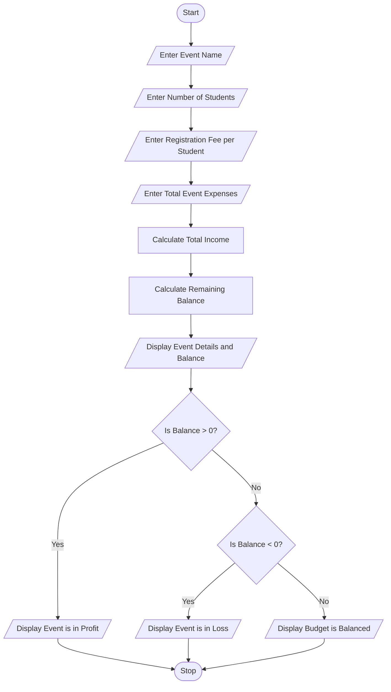

# Problem Statement

The Campus Event Financial Planning system is designed to calculate the total income, total expenses, and remaining balance of a college event.

The program accepts the event name, number of students, registration fee per student, and total event expenses. It calculates the total income and compares it with the expenses to identify whether the event is in profit, in loss, or has a balanced budget.

# Objectives

1. To enter the event name.
2. To enter the number of students participating in the event.
3. To enter the registration fee per student.
4. To enter the total event expenses.
5. To calculate the total income.
6. To calculate the remaining balance.
7. To identify whether the event is in profit, loss, or has a balanced budget.

# Assumptions

1. The event name is entered by the user.
2. The number of students is entered as a whole number.
3. The registration fee is the same for all students.
4. The registration fee and expenses are entered in Indian Rupees.
5. All registered students pay the registration fee.
6. No additional income sources are included.
7. The number of students, registration fee, and expenses are assumed to be non-negative.

# Algorithm

1. Start the program.
2. Enter the event name.
3. Enter the number of students.
4. Enter the registration fee per student.
5. Enter the total event expenses.
6. Calculate total income using students × fee.
7. Calculate the remaining balance using income − expenses.
8. Display the event name.
9. Display the total income.
10. Display the total expenses.
11. Display the remaining balance.
12. If the balance is greater than zero, display "Event is in Profit".
13. If the balance is less than zero, display "Event is in Loss".
14. Otherwise, display "Budget is Balanced".
15. Stop the program.

# Flowchart 



# Pseudocode

```text id="w5h2k8"
START

INPUT event
INPUT students
INPUT fee
INPUT expenses

income = students * fee

balance = income - expenses

DISPLAY event
DISPLAY income
DISPLAY expenses
DISPLAY balance

IF balance > 0 THEN
    DISPLAY "Event is in Profit"

ELSE IF balance < 0 THEN
    DISPLAY "Event is in Loss"

ELSE
    DISPLAY "Budget is Balanced"

END IF

STOP
```

# Source Code 

```python
event = input("Enter event name: ")
students = int(input("Enter number of students: "))
fee = int(input("Enter registration fee per student: "))
expenses = int(input("Enter total event expenses: "))

income = students * fee
balance = income - expenses

print("Event Name:", event)
print("Total Income:", income)
print("Total Expenses:", expenses)
print("Remaining Balance:", balance)

if balance > 0:
    print("Event is in Profit")
elif balance < 0:
    print("Event is in Loss")
else:
    print("Budget is Balanced")
```

# Test Cases

| Test Case | Students | Fee per Student | Expenses | Expected Result |
|---|---:|---:|---:|---|
| 1 | 100 | ₹200 | ₹15,000 | Profit ₹5,000 |
| 2 | 50 | ₹100 | ₹6,000 | Loss ₹1,000 |
| 3 | 100 | ₹150 | ₹15,000 | Budget Balanced |
| 4 | 200 | ₹250 | ₹40,000 | Profit ₹10,000 |

#  Sample Output 

**Test Case 1 – Event is in Profit**

```text
Enter event name: College Fest
Enter number of students: 100
Enter registration fee per student: 200
Enter total event expenses: 15000

Event Name: College Fest
Total Income: 20000
Total Expenses: 15000
Remaining Balance: 5000
Event is in Profit
```

**Test Case 2 – Event is in Loss**

```text
Enter event name: Sports Day
Enter number of students: 50
Enter registration fee per student: 100
Enter total event expenses: 6000

Event Name: Sports Day
Total Income: 5000
Total Expenses: 6000
Remaining Balance: -1000
Event is in Loss
```

**Test Case 3 – Budget is Balanced**

```text
Enter event name: Cultural Day
Enter number of students: 100
Enter registration fee per student: 150
Enter total event expenses: 15000

Event Name: Cultural Day
Total Income: 15000
Total Expenses: 15000
Remaining Balance: 0
Budget is Balanced
```

**Test Case 4 – Event is in Profit**

```text
Enter event name: Technical Fest
Enter number of students: 200
Enter registration fee per student: 250
Enter total event expenses: 40000

Event Name: Technical Fest
Total Income: 50000
Total Expenses: 40000
Remaining Balance: 10000
Event is in Profit
```

# Conclusion

The Campus Event Financial Planning program successfully calculates the total income, total expenses, and remaining balance of a college event. It identifies whether the event is in profit, in loss, or has a balanced budget. This simple Python program helps students understand basic input operations, arithmetic calculations, and conditional statements. It can be useful for planning and managing college event budgets.
