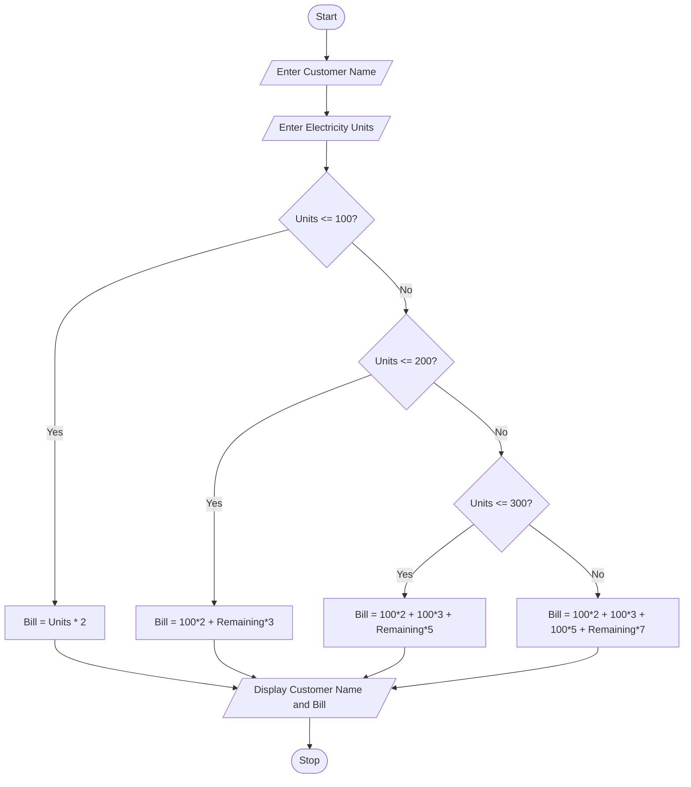

##  Problem Statement

The Progressive Electricity Billing System is designed to calculate the electricity bill based on the number of units consumed by a customer.

The system takes the customer name and electricity units as input. It calculates the total bill using different rates for different unit ranges.

The electricity charges are calculated as follows:

- First 100 units: ₹2 per unit.
- Next 100 units (101–200): ₹3 per unit.
- Next 100 units (201–300): ₹5 per unit.
- Above 300 units: ₹7 per unit.

The system displays the customer name and total electricity bill.

## Objectives

1. To calculate electricity bills automatically.
2. To reduce manual calculation errors.
3. To apply different electricity rates based on unit consumption.
4. To understand the use of conditional statements in Python.
5. To display the customer's total electricity bill.

## Assumptions

1. The customer enters a valid name.
2. Electricity units are entered as a whole number.
3. Electricity units cannot be negative.
4. The billing rates are fixed for this project.
5. The billing system uses progressive calculation.
6. No additional taxes or charges are included.

##  Algorithm

**Step 1:** Start the program.

**Step 2:** Enter the customer name.

**Step 3:** Enter the electricity units consumed.

**Step 4:** Check the number of units.

**Step 5:** Calculate the bill based on the following conditions:

- If units are less than or equal to 100, multiply units by 2.
- If units are less than or equal to 200, calculate the first 100 units at ₹2 and remaining units at ₹3.
- If units are less than or equal to 300, calculate the first 100 units at ₹2, next 100 units at ₹3, and remaining units at ₹5.
- Otherwise, calculate the first 300 units using their respective rates and remaining units at ₹7.

**Step 6:** Display the customer name.

**Step 7:** Display the total electricity bill.

**Step 8:** Stop the program.

## Flowchart



## Pseudocode

```text
START

INPUT customer_name
INPUT units

IF units <= 100 THEN
    bill = units * 2

ELSE IF units <= 200 THEN
    bill = 100 * 2 + (units - 100) * 3

ELSE IF units <= 300 THEN
    bill = 100 * 2 + 100 * 3 + (units - 200) * 5

ELSE
    bill = 100 * 2 + 100 * 3 + 100 * 5
           + (units - 300) * 7

END IF

PRINT customer_name
PRINT bill

STOP
```

## Source Code 
```
name = input("Enter customer name: ")
units = int(input("Enter electricity units: "))

if units <= 100:
    bill = units * 2

elif units <= 200:
    bill = 100 * 2 + (units - 100) * 3

elif units <= 300:
    bill = 100 * 2 + 100 * 3 + (units - 200) * 5

else:
    bill = 100 * 2 + 100 * 3 + 100 * 5 + (units - 300) * 7

print("Customer Name:", name)
print("Total Electricity Bill: Rs.", bill)
```

## 8. Test Cases

| Test Case | Units Consumed | Expected Bill |
|---|---:|---:|
| 1 | 50 | ₹100 |
| 2 | 100 | ₹200 |
| 3 | 150 | ₹350 |
| 4 | 200 | ₹500 |
| 5 | 250 | ₹750 |
| 6 | 300 | ₹1,000 |
| 7 | 350 | ₹1,350 |

### Test Case 
**Test Case 1:**
- Input: 50 units
- Calculation: 50 × 2 = ₹100
- Expected Output: ₹100

**Test Case 2:**
- Input: 150 units
- Calculation: (100 × 2) + (50 × 3)
- Expected Output: ₹350

**Test Case 3:**
- Input: 250 units
- Calculation: (100 × 2) + (100 × 3) + (50 × 5)
- Expected Output: ₹750

**Test Case 4:**
- Input: 350 units
- Calculation: (100 × 2) + (100 × 3) + (100 × 5) + (50 × 7)
- Expected Output: ₹1,350

##  Sample Outputs

### Output 1: Customer Consumes 50 Units

```text
Enter customer name: Vennela
Enter electricity units: 50

Customer Name: Vennela
Total Electricity Bill: Rs. 100
```

### Output 2: Customer Consumes 150 Units

```text
Enter customer name: Rahul
Enter electricity units: 150

Customer Name: Rahul
Total Electricity Bill: Rs. 350
```

### Output 3: Customer Consumes 250 Units

```text
Enter customer name: Priya
Enter electricity units: 250

Customer Name: Priya
Total Electricity Bill: Rs. 750
```

### Output 4: Customer Consumes 350 Units

```text
Enter customer name: Arun
Enter electricity units: 350

Customer Name: Arun
Total Electricity Bill: Rs. 1350
```

## Conclusion

The Progressive Electricity Billing System successfully calculates electricity bills based on the number of units consumed by a customer.

The project uses Python programming concepts such as input statements, output statements, arithmetic operators, and conditional statements (if, elif, and else).

This project helps us understand how progressive billing calculations work and how Python can be used to solve real-world problems easily.

