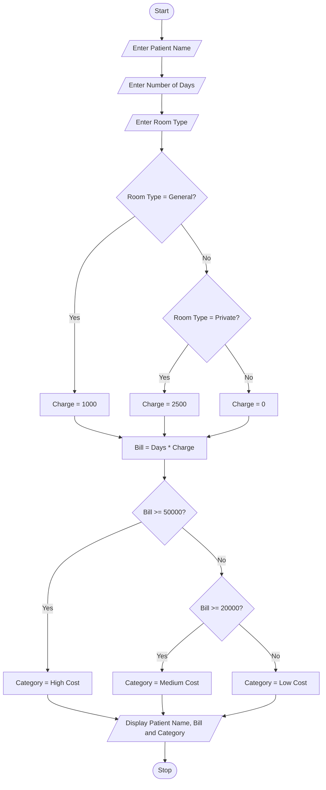

## Problem Statement

The Hospital Billing and Patient Classification System is designed to calculate the hospital bill based on the number of days a patient stays in the hospital and the type of room selected.

The system takes the patient name, number of days, and room type as input. It calculates the total hospital bill based on the room charges.

The room charges are:

- General Room: ₹1,000 per day.
- Private Room: ₹2,500 per day.

Based on the total bill, the patient is classified into three categories:

- High Cost: Bill is ₹50,000 or above.
- Medium Cost: Bill is ₹20,000 or above.
- Low Cost: Bill is below ₹20,000.

Finally, the system displays the patient name, total bill, and patient category.

## Objectives

1. To calculate hospital bills automatically.
2. To identify the room type selected by the patient.
3. To calculate charges based on the number of hospital days.
4. To classify patients based on their total bill.
5. To reduce manual calculation errors.
6. To understand Python conditional statements.

## Assumptions

1. The patient enters a valid name.
2. The number of hospital days is entered as a whole number.
3. The room type must be General or Private.
4. General room charges are fixed at ₹1,000 per day.
5. Private room charges are fixed at ₹2,500 per day.
6. The bill is calculated by multiplying the number of days by the room charge.
7. No additional medical charges, taxes, or discounts are included.
8. The number of days must be greater than zero.

## Algorithm

**Step 1:** Start the program.

**Step 2:** Enter the patient name.

**Step 3:** Enter the number of hospital days.

**Step 4:** Enter the room type (General or Private).

**Step 5:** Check the room type.

- If the room type is General, charge ₹1,000 per day.
- If the room type is Private, charge ₹2,500 per day.
- Otherwise, assign zero as the room charge.

**Step 6:** Calculate the total bill.

Total Bill = Number of Days × Room Charge

**Step 7:** Check the total bill.

- If the bill is ₹50,000 or above, classify as High Cost.
- If the bill is ₹20,000 or above, classify as Medium Cost.
- Otherwise, classify as Low Cost.

**Step 8:** Display the patient name.

**Step 9:** Display the total hospital bill.

**Step 10:** Display the patient category.

**Step 11:** Stop the program.

## Flowchart



## Pseudocode

```text
START

INPUT patient_name
INPUT days
INPUT room_type

IF room_type = "General" THEN
    charge = 1000

ELSE IF room_type = "Private" THEN
    charge = 2500

ELSE
    charge = 0

END IF

bill = days * charge

IF bill >= 50000 THEN
    category = "High Cost"

ELSE IF bill >= 20000 THEN
    category = "Medium Cost"

ELSE
    category = "Low Cost"

END IF

PRINT patient_name
PRINT bill
PRINT category

STOP
```

##  Source Code
```python
name = input("Enter patient name: ")
days = int(input("Enter number of days: "))
room = input("Enter room type (General/Private): ")

if room == "General":
    charge = 1000

elif room == "Private":
    charge = 2500

else:
    charge = 0

bill = days * charge

if bill >= 50000:
    category = "High Cost"

elif bill >= 20000:
    category = "Medium Cost"

else:
    category = "Low Cost"

print("Patient Name:", name)
print("Total Bill: Rs.", bill)
print("Patient Category:", category)
```

## Test Cases

| Test Case | Room Type | Days | Expected Bill | Category |
|---|---|---:|---:|---|
| 1 | General | 5 | ₹5,000 | Low Cost |
| 2 | General | 20 | ₹20,000 | Medium Cost |
| 3 | Private | 10 | ₹25,000 | Medium Cost |
| 4 | Private | 20 | ₹50,000 | High Cost |
| 5 | Private | 25 | ₹62,500 | High Cost |
| 6 | General | 50 | ₹50,000 | High Cost |

### Test Case Explanation

**Test Case 1:**
- Patient Name: Rahul
- Room Type: General
- Days: 5
- Calculation: 5 × 1,000 = ₹5,000
- Expected Category: Low Cost

**Test Case 2:**
- Patient Name: Priya
- Room Type: General
- Days: 20
- Calculation: 20 × 1,000 = ₹20,000
- Expected Category: Medium Cost

**Test Case 3:**
- Patient Name: Arun
- Room Type: Private
- Days: 10
- Calculation: 10 × 2,500 = ₹25,000
- Expected Category: Medium Cost

**Test Case 4:**
- Patient Name: Vennela
- Room Type: Private
- Days: 20
- Calculation: 20 × 2,500 = ₹50,000
- Expected Category: High Cost

##  Sample Outputs

### Output 1: General Room – Low Cost

```text
Enter patient name: Rahul
Enter number of days: 5
Enter room type (General/Private): General

Patient Name: Rahul
Total Bill: Rs. 5000
Patient Category: Low Cost
```

### Output 2: General Room – Medium Cost

```text
Enter patient name: Priya
Enter number of days: 20
Enter room type (General/Private): General

Patient Name: Priya
Total Bill: Rs. 20000
Patient Category: Medium Cost
```

### Output 3: Private Room – Medium Cost

```text
Enter patient name: Arun
Enter number of days: 10
Enter room type (General/Private): Private

Patient Name: Arun
Total Bill: Rs. 25000
Patient Category: Medium Cost
```

### Output 4: Private Room – High Cost

```text
Enter patient name: Vennela
Enter number of days: 20
Enter room type (General/Private): Private

Patient Name: Vennela
Total Bill: Rs. 50000
Patient Category: High Cost
```

## Conclusion

The Hospital Billing and Patient Classification System successfully calculates hospital bills based on the patient's room type and number of hospital days.

The project uses basic Python concepts such as input statements, output statements, arithmetic operators, and conditional statements (if, elif, and else).

It helps to reduce manual calculations and makes hospital billing easier to understand and perform.

**Thus, the Hospital Billing and Patient Classification System provides a simple method for calculating hospital bills and classifying patients according to their total expenses.**
