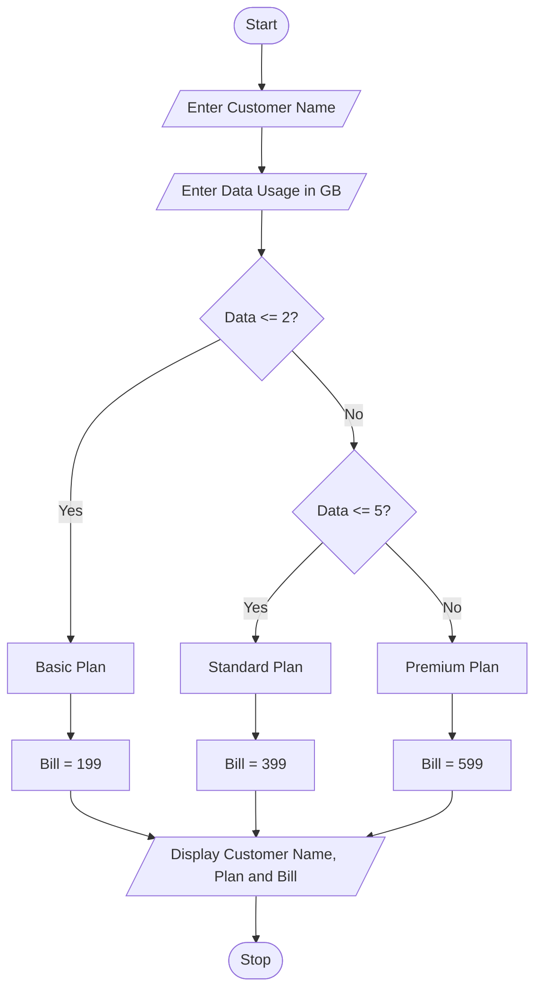

## Problem Statement
The Multi-Plan Telecommunications Cost Optimization system is designed to select a suitable mobile data plan based on the customer's data usage.

The system takes the customer name and data usage in GB as input. Based on the data usage, it automatically selects a suitable plan and displays the total bill.

The available plans are:

- **Basic Plan:** Up to 2 GB – ₹199.
- **Standard Plan:** Above 2 GB and up to 5 GB – ₹399.
- **Premium Plan:** Above 5 GB – ₹599.

Finally, the system displays the customer name, selected plan, and total bill.

## Objectives

1. To select a suitable data plan based on data usage.
2. To calculate the mobile data plan cost automatically.
3. To reduce manual plan selection.
4. To display the selected plan and total bill.
5. To understand conditional statements in Python.
6. To make data plan selection simple and efficient.

##  Assumptions

1. The customer enters a valid name.
2. Data usage is entered as a whole number in GB.
3. Data usage cannot be negative.
4. The Basic Plan costs ₹199.
5. The Standard Plan costs ₹399.
6. The Premium Plan costs ₹599.
7. The plan is selected based on the entered data usage.
8. No additional taxes or charges are included.

## Algorithm

**Step 1:** Start the program.

**Step 2:** Enter the customer name.

**Step 3:** Enter data usage in GB.

**Step 4:** Check the data usage.

**Step 5:** If data usage is less than or equal to 2 GB, select the Basic Plan and set the bill to ₹199.

**Step 6:** If data usage is less than or equal to 5 GB, select the Standard Plan and set the bill to ₹399.

**Step 7:** Otherwise, select the Premium Plan and set the bill to ₹599.

**Step 8:** Display the customer name.

**Step 9:** Display the selected plan.

**Step 10:** Display the total bill.

**Step 11:** Stop the program.

## Flowchart



## Pseudocode

```text id="w7m9zp"
START

INPUT customer_name
INPUT data

IF data <= 2 THEN
    plan = "Basic Plan"
    bill = 199

ELSE IF data <= 5 THEN
    plan = "Standard Plan"
    bill = 399

ELSE
    plan = "Premium Plan"
    bill = 599

END IF

PRINT customer_name
PRINT plan
PRINT bill

STOP
```

## Source Code (Python)

```python id="p3k8mz"
name = input("Enter customer name: ")
data = int(input("Enter data usage in GB: "))

if data <= 2:
    plan = "Basic Plan"
    bill = 199

elif data <= 5:
    plan = "Standard Plan"
    bill = 399

else:
    plan = "Premium Plan"
    bill = 599

print("Customer Name:", name)
print("Selected Plan:", plan)
print("Total Bill: Rs.", bill)
```

## Test Cases

| Test Case | Data Usage | Expected Plan | Expected Bill |
|---|---:|---|---:|
| 1 | 1 GB | Basic Plan | ₹199 |
| 2 | 2 GB | Basic Plan | ₹199 |
| 3 | 3 GB | Standard Plan | ₹399 |
| 4 | 5 GB | Standard Plan | ₹399 |
| 5 | 6 GB | Premium Plan | ₹599 |
| 6 | 10 GB | Premium Plan | ₹599 |

### Test Case Explanation

**Test Case 1:**
- Customer Name: Rahul
- Data Usage: 1 GB
- Selected Plan: Basic Plan
- Expected Bill: ₹199

**Test Case 2:**
- Customer Name: Priya
- Data Usage: 3 GB
- Selected Plan: Standard Plan
- Expected Bill: ₹399

**Test Case 3:**
- Customer Name: Arun
- Data Usage: 6 GB
- Selected Plan: Premium Plan
- Expected Bill: ₹599

**Test Case 4:**
- Customer Name: Vennela
- Data Usage: 5 GB
- Selected Plan: Standard Plan
- Expected Bill: ₹399

## Sample Outputs

Run the Python program and capture the actual console screenshots for your project submission.

### Output 1: Basic Plan

```text
Enter customer name: Rahul
Enter data usage in GB: 1

Customer Name: Rahul
Selected Plan: Basic Plan
Total Bill: Rs. 199
```

### Output 2: Standard Plan

```text
Enter customer name: Priya
Enter data usage in GB: 3

Customer Name: Priya
Selected Plan: Standard Plan
Total Bill: Rs. 399
```

### Output 3: Premium Plan

```text
Enter customer name: Arun
Enter data usage in GB: 6

Customer Name: Arun
Selected Plan: Premium Plan
Total Bill: Rs. 599
```

### Output 4: Standard Plan at 5 GB

```text
Enter customer name: Vennela
Enter data usage in GB: 5

Customer Name: Vennela
Selected Plan: Standard Plan
Total Bill: Rs. 399
```

## Conclusion

The Multi-Plan Telecommunications Cost Optimization system successfully selects a mobile data plan based on the customer's data usage.

The project uses basic Python concepts such as input statements, output statements, variables, and conditional statements (if, elif, and else).

It helps customers select a suitable data plan easily and displays the correct bill according to their data usage.
