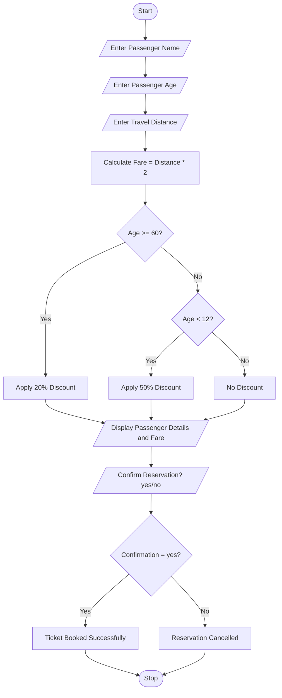

##  Problem Statement

The Railway Fare and Reservation Calculator is designed to calculate the train ticket fare based on the passenger's age and travel distance.

The system takes the passenger name, age, and travel distance as input. It calculates the ticket fare at a basic rate of ₹2 per kilometre.

Discounts are provided based on the passenger's age:

- Senior Citizens (60 years and above): 20% discount.
- Children (below 12 years): 50% discount.
- Adults (12 to 59 years): No discount.

After calculating the fare, the system asks the passenger to confirm the reservation.

If the passenger enters "yes", the ticket is booked successfully. Otherwise, the reservation is cancelled.

## Objectives

1. To calculate railway ticket fares automatically.
2. To provide discounts based on passenger age.
3. To calculate fares based on travel distance.
4. To confirm or cancel ticket reservations.
5. To reduce manual fare calculation errors.
6. To understand conditional statements in Python.

##  Assumptions

1. The passenger enters a valid name.
2. Age is entered as a whole number.
3. Travel distance is entered in kilometres.
4. The basic fare is ₹2 per kilometre.
5. Senior citizens receive a 20% discount.
6. Children below 12 years receive a 50% discount.
7. Adults receive no discount.
8. Reservation confirmation is entered as "yes" or "no".
9. No additional taxes or booking charges are included.

##  Algorithm

**Step 1:** Start the program.

**Step 2:** Enter the passenger name.

**Step 3:** Enter the passenger age.

**Step 4:** Enter the travel distance.

**Step 5:** Calculate the basic fare.

Basic Fare = Distance × 2

**Step 6:** Check the passenger age.

- If age is 60 or above, apply a 20% discount.
- If age is below 12, apply a 50% discount.
- Otherwise, no discount is applied.

**Step 7:** Display the passenger name.

**Step 8:** Display the travel distance.

**Step 9:** Display the final ticket fare.

**Step 10:** Ask the passenger to confirm the reservation.

**Step 11:** If the passenger enters "yes", display Ticket Booked Successfully.

**Step 12:** Otherwise, display Reservation Cancelled.

**Step 13:** Stop the program.

## Flowchart



##  Pseudocode

```text
START

INPUT passenger_name
INPUT age
INPUT distance

fare = distance * 2

IF age >= 60 THEN
    fare = fare * 0.80

ELSE IF age < 12 THEN
    fare = fare * 0.50

END IF

PRINT passenger_name
PRINT distance
PRINT fare

INPUT confirm

IF confirm = "yes" THEN
    PRINT "Ticket Booked Successfully"

ELSE
    PRINT "Reservation Cancelled"

END IF

STOP
```

## Source Code 

```python
name = input("Enter passenger name: ")
age = int(input("Enter passenger age: "))
distance = int(input("Enter travel distance: "))

fare = distance * 2

if age >= 60:
    fare = fare * 0.80

elif age < 12:
    fare = fare * 0.50

print("Passenger Name:", name)
print("Travel Distance:", distance, "km")
print("Ticket Fare: Rs.", fare)

confirm = input("Confirm reservation? (yes/no): ")

if confirm == "yes":
    print("Ticket Booked Successfully")
else:
    print("Reservation Cancelled")
```

## Test Cases

| Test Case | Age | Distance | Expected Fare | Discount |
|---|---:|---:|---:|---|
| 1 | 25 | 100 km | ₹200 | No discount |
| 2 | 65 | 100 km | ₹160 | 20% |
| 3 | 10 | 100 km | ₹100 | 50% |
| 4 | 60 | 200 km | ₹320 | 20% |
| 5 | 15 | 150 km | ₹300 | No discount |
| 6 | 8 | 200 km | ₹200 | 50% |

### Test Case Explanation

**Test Case 1: Adult Passenger**
- Name: Rahul
- Age: 25
- Distance: 100 km
- Calculation: 100 × 2 = ₹200
- Expected Fare: ₹200

**Test Case 2: Senior Citizen**
- Name: Priya
- Age: 65
- Distance: 100 km
- Calculation: 200 × 0.80 = ₹160
- Expected Fare: ₹160

**Test Case 3: Child Passenger**
- Name: Arun
- Age: 10
- Distance: 100 km
- Calculation: 200 × 0.50 = ₹100
- Expected Fare: ₹100

**Test Case 4: Senior Citizen**
- Name: Vennela
- Age: 60
- Distance: 200 km
- Calculation: 400 × 0.80 = ₹320
- Expected Fare: ₹320

## Sample Outputs

Run the Python program and capture the actual console screenshots for your project submission.

### Output 1: Adult Passenger – Reservation Confirmed

```text
Enter passenger name: Rahul
Enter passenger age: 25
Enter travel distance: 100

Passenger Name: Rahul
Travel Distance: 100 km
Ticket Fare: Rs. 200
Confirm reservation? (yes/no): yes
Ticket Booked Successfully
```

### Output 2: Senior Citizen – Reservation Confirmed

```text
Enter passenger name: Priya
Enter passenger age: 65
Enter travel distance: 100

Passenger Name: Priya
Travel Distance: 100 km
Ticket Fare: Rs. 160.0
Confirm reservation? (yes/no): yes
Ticket Booked Successfully
```

### Output 3: Child Passenger – Reservation Confirmed

```text
Enter passenger name: Arun
Enter passenger age: 10
Enter travel distance: 100

Passenger Name: Arun
Travel Distance: 100 km
Ticket Fare: Rs. 100.0
Confirm reservation? (yes/no): yes
Ticket Booked Successfully
```

### Output 4: Adult Passenger – Reservation Cancelled

```text
Enter passenger name: Vennela
Enter passenger age: 25
Enter travel distance: 150

Passenger Name: Vennela
Travel Distance: 150 km
Ticket Fare: Rs. 300
Confirm reservation? (yes/no): no
Reservation Cancelled
```

## Conclusion

The Railway Fare and Reservation Calculator successfully calculates train ticket fares based on passenger age and travel distance.

The project uses basic Python concepts such as input statements, output statements, arithmetic operators, and conditional statements (if, elif, and else).

It provides age-based discounts and allows passengers to confirm or cancel their reservations.

