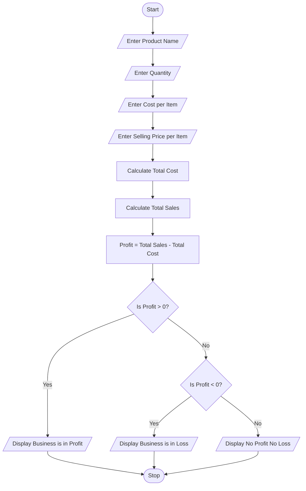

#  Problem Statement
The Manufacturing Cost and Profitability Analysis system is designed to calculate the total cost, total sales, and profit or loss of a product based on its quantity, cost per item, and selling price per item.

The system accepts product details from the user, calculates the total manufacturing cost and total sales, and determines whether the business is making a profit, facing a loss, or having no profit and no loss.

# Objectives

1. To enter the product name.
2. To enter the quantity of products.
3. To calculate the total manufacturing cost.
4. To calculate the total sales amount.
5. To calculate the profit or loss.
6. To identify the business status.

# Assumptions

1. The product name is entered by the user.
2. Quantity must be entered as a whole number.
3. Cost per item and selling price per item are entered in rupees.
4. Quantity, cost, and selling price are assumed to be non-negative.
5. All products are assumed to be sold.
6. No additional taxes or expenses are included.

#  Algorithm

1. Start the program.
2. Enter the product name.
3. Enter the quantity of products.
4. Enter the cost per item.
5. Enter the selling price per item.
6. Calculate total cost using quantity × cost per item.
7. Calculate total sales using quantity × selling price per item.
8. Calculate profit using total sales − total cost.
9. If profit is greater than zero, display "Business is in Profit".
10. If profit is less than zero, display "Business is in Loss".
11. Otherwise, display "No Profit No Loss".
12. Stop the program.

#  Flowchart 


# Pseudocode

```text
START

INPUT product
INPUT quantity
INPUT cost
INPUT selling

total_cost = quantity * cost
total_sales = quantity * selling

profit = total_sales - total_cost

PRINT product
PRINT total_cost
PRINT total_sales
PRINT profit

IF profit > 0 THEN
    PRINT "Business is in Profit"

ELSE IF profit < 0 THEN
    PRINT "Business is in Loss"

ELSE
    PRINT "No Profit No Loss"

END IF

STOP
```

# Source Code 

```python
product = input("Enter product name: ")
quantity = int(input("Enter quantity: "))
cost = int(input("Enter cost per item: "))
selling = int(input("Enter selling price per item: "))

total_cost = quantity * cost
total_sales = quantity * selling

profit = total_sales - total_cost

print("Product Name:", product)
print("Total Cost:", total_cost)
print("Total Sales:", total_sales)
print("Profit:", profit)

if profit > 0:
    print("Business is in Profit")
elif profit < 0:
    print("Business is in Loss")
else:
    print("No Profit No Loss")
```

# Test Cases

| Test Case | Quantity | Cost per Item | Selling Price | Expected Result |
|---|---:|---:|---:|---|
| 1 | 10 | ₹100 | ₹150 | Profit ₹500 |
| 2 | 10 | ₹200 | ₹150 | Loss ₹500 |
| 3 | 5 | ₹100 | ₹100 | No Profit No Loss |
| 4 | 20 | ₹50 | ₹80 | Profit ₹600 |

# 9. Sample Output 

**Test Case 1 – Business in Profit**

```text
Enter product name: Pen
Enter quantity: 10
Enter cost per item: 100
Enter selling price per item: 150

Product Name: Pen
Total Cost: 1000
Total Sales: 1500
Profit: 500
Business is in Profit
```

**Test Case 2 – Business in Loss**

```text
Enter product name: Book
Enter quantity: 10
Enter cost per item: 200
Enter selling price per item: 150

Product Name: Book
Total Cost: 2000
Total Sales: 1500
Profit: -500
Business is in Loss
```

**Test Case 3 – No Profit No Loss**

```text
Enter product name: Pencil
Enter quantity: 5
Enter cost per item: 100
Enter selling price per item: 100

Product Name: Pencil
Total Cost: 500
Total Sales: 500
Profit: 0
No Profit No Loss
```

# Conclusion

The Manufacturing Cost and Profitability Analysis program successfully calculates the total manufacturing cost, total sales, and profit or loss of a product. It identifies whether the business is making a profit, facing a loss, or having no profit and no loss. This simple Python program helps beginners understand basic arithmetic operations and conditional statements in real-world business calculations.
