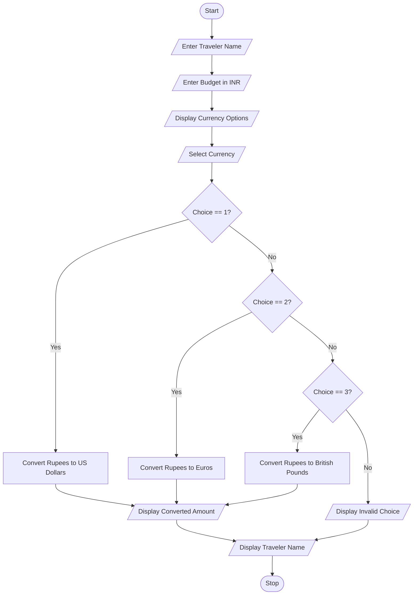

# Problem Statement

The Multi-Currency Travel Budget Analysis system is designed to convert a traveler's budget from Indian Rupees (INR) into different foreign currencies.

The program accepts the traveler's name and budget in Indian Rupees. The user can select US Dollar, Euro, or British Pound. Based on the selected currency, the program converts the amount using predefined exchange rates and displays the converted amount.

# Objectives

1. To enter the traveler's name.
2. To enter the travel budget in Indian Rupees.
3. To display different foreign currency options.
4. To allow the user to select a currency.
5. To convert Indian Rupees into the selected currency.
6. To display the converted amount and traveler name.

#  Assumptions

1. The traveler's name is entered as text.
2. The budget is entered in Indian Rupees.
3. The budget can contain decimal values.
4. The exchange rates are predefined in the program.
5. The exchange rates used are:
   - 1 US Dollar = ₹85
   - 1 Euro = ₹95
   - 1 British Pound = ₹110
6. The user must select a valid currency option (1, 2, or 3).
7. The exchange rates are examples for this project and may not represent current market rates.

#  Algorithm

1. Start the program.
2. Enter the traveler's name.
3. Enter the travel budget in Indian Rupees.
4. Display the currency options:
   - 1. US Dollar
   - 2. Euro
   - 3. British Pound
5. Ask the user to select a currency.
6. If the choice is 1, divide the budget by 85 and display US Dollars.
7. If the choice is 2, divide the budget by 95 and display Euros.
8. If the choice is 3, divide the budget by 110 and display British Pounds.
9. If the choice is invalid, display "Invalid Choice".
10. Display the traveler's name.
11. Stop the program.

# Flowchart



#  Pseudocode

```text
START

INPUT name
INPUT rupees

DISPLAY "1. US Dollar"
DISPLAY "2. Euro"
DISPLAY "3. British Pound"

INPUT choice

IF choice == 1 THEN
    converted = rupees / 85
    DISPLAY "US Dollars:", converted

ELSE IF choice == 2 THEN
    converted = rupees / 95
    DISPLAY "Euros:", converted

ELSE IF choice == 3 THEN
    converted = rupees / 110
    DISPLAY "British Pounds:", converted

ELSE
    DISPLAY "Invalid Choice"

END IF

DISPLAY "Traveler Name:", name

STOP
```

# Source Code 

```python
name = input("Enter traveler name: ")
rupees = float(input("Enter budget in Indian Rupees: "))

print("1. US Dollar")
print("2. Euro")
print("3. British Pound")

choice = int(input("Select currency: "))

if choice == 1:
    converted = rupees / 85
    print("US Dollars:", converted)
elif choice == 2:
    converted = rupees / 95
    print("Euros:", converted)
elif choice == 3:
    converted = rupees / 110
    print("British Pounds:", converted)
else:
    print("Invalid Choice")

print("Traveler Name:", name)
```

# Test Cases

| Test Case | Budget (INR) | Choice | Expected Output |
|---|---:|---:|---|
| 1 | ₹8500 | 1 | 100 US Dollars |
| 2 | ₹9500 | 2 | 100 Euros |
| 3 | ₹11000 | 3 | 100 British Pounds |
| 4 | ₹5000 | 4 | Invalid Choice |

#  Sample Output

**Test Case 1 – US Dollar Conversion**

```text
Enter traveler name: Ravi
Enter budget in Indian Rupees: 8500
1. US Dollar
2. Euro
3. British Pound
Select currency: 1
US Dollars: 100.0
Traveler Name: Ravi
```

**Test Case 2 – Euro Conversion**

```text
Enter traveler name: Priya
Enter budget in Indian Rupees: 9500
1. US Dollar
2. Euro
3. British Pound
Select currency: 2
Euros: 100.0
Traveler Name: Priya
```

**Test Case 3 – British Pound Conversion**

```text
Enter traveler name: Arun
Enter budget in Indian Rupees: 11000
1. US Dollar
2. Euro
3. British Pound
Select currency: 3
British Pounds: 100.0
Traveler Name: Arun
```

**Test Case 4 – Invalid Currency Choice**

```text
Enter traveler name: Meena
Enter budget in Indian Rupees: 5000
1. US Dollar
2. Euro
3. British Pound
Select currency: 4
Invalid Choice
Traveler Name: Meena
```

# Conclusion

The Multi-Currency Travel Budget Analysis program successfully converts a traveler's budget from Indian Rupees into US Dollars, Euros, and British Pounds using predefined exchange rates. It also checks the user's currency selection and displays an error message for an invalid choice. This program helps beginners understand input statements, arithmetic operations, and conditional statements in Python.
